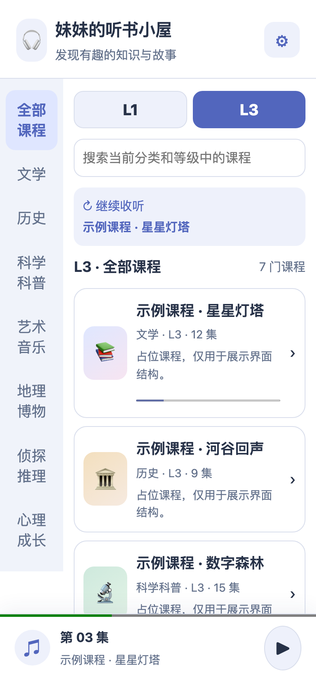
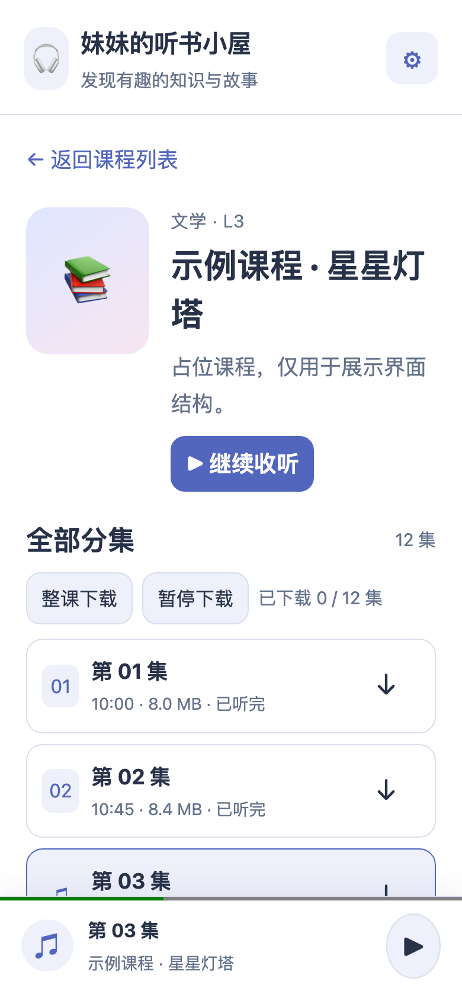
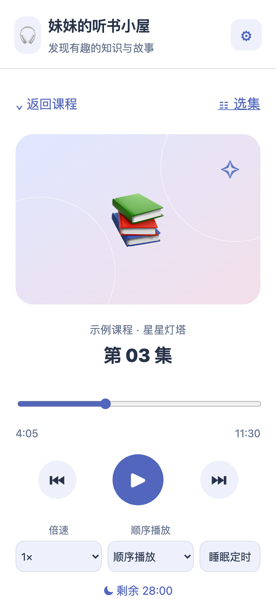

# Sister's Audiobook Cabin

Turns the audiobook courses your family already owns into a private listening cabin on your kid's phone: browse by subject and level, play episode by episode, set a sleep timer, and keep listening offline. No app store, no login, and the audio never leaves your home.

[简体中文](./README.md) | English

<table>
  <tr>
    <td align="center"></td>
    <td align="center"></td>
    <td align="center"></td>
  </tr>
</table>

> The screenshots above use placeholder course data; the UI is identical to the real product. Real course titles and audio files never enter this repository.

## What is this

We bought a pile of audiobook courses for our kid, but the files just sat on a hard drive — listening once meant going through the computer first. This project turns a local audio folder into a web cabin you can install on a phone and listen to offline: the family computer acts as the library server, and the phone opens, downloads, and keeps playing without a network. It fits any household that has "audio files on a local disk and wants everyone to listen anywhere at home".

## Features

- **Subject × level library**: a rail of 7 subjects (literature, history, science, art & music, geography, mystery, personal growth), L1–L5 level tabs and search — find a course in seconds;
- **Real episodes and listening history**: episodes sorted in natural file order; how much you have heard and where you stopped survives page changes;
- **A complete player**: speed from 0.75× to 2×, sequence/single/list loop modes, sleep timer (15/30/60 minutes or end of episode), lock-screen media controls;
- **Whole-course offline**: download an entire course with visible progress, pausable and resumable; once installed to the home screen, downloaded episodes play with no network;
- **Privacy first**: audio is served only over the home network, never uploaded or publicly hosted; the UI itself says "family-private use only";
- **Chinese / English UI and light / dark / system themes**, switchable in Settings and applied instantly.

## Quick start

Requires Node.js 22 and pnpm. Put your audiobook files under `兴趣测试/` (layout: `level/subject/course-folder/xxx.mp3`), then:

```sh
pnpm install
pnpm audio:scan   # scan audio and build catalog/audio-index.json
pnpm build        # build the frontend and PWA assets
pnpm serve        # serve at http://127.0.0.1:8792/ by default
```

Open that address in the computer's browser. If the port is taken: `APP_PORT=<free-port> pnpm serve`.

### Install on a phone

```sh
node scripts/android-preview.mjs
```

Safely exposes the page over USB to an authorized Android phone (picks a free port, touches nothing else); open the printed link in Chrome on the phone and tap "Install" in Settings — downloaded courses then work offline.

### Demo mode (no real data)

```sh
node scripts/serve-demo.mjs   # http://127.0.0.1:8891 with placeholder courses, UI preview only
```

## Development

```sh
pnpm dev          # frontend dev mode (API proxied to 8792; override with API_PROXY_TARGET)
pnpm test         # vitest suite (unit / component / node / browser)
pnpm ts-check     # TypeScript check
pnpm lint         # ESLint
```

## Project layout

- `src/audio/` — the listening app (library, course, player, offline cache, engine, i18n)
- `audiobook-server.mjs` + `server/` — local server: course API, HTTP Range audio streaming, static files
- `scripts/` — audio scanner, Android USB preview, PWA build, demo instance
- `docs/qa/P51-运行与安装说明.md` — full runtime and installation boundaries (Chinese)
- `docs/qa/P51-最终交付与HumanGate.md` — delivery and acceptance records (Chinese)

## Known limitations

- The course manifest, real audio and scan details stay on the local machine only and are excluded from the repository (see `.gitignore`); a fresh clone must supply its own audio folder and course manifest, then run `pnpm audio:scan`.
- Offline audio lives in the phone browser's cache; clearing site data or OS storage reclamation removes it (listening history is kept).
- Four damaged source files are currently marked unplayable in the UI; everything else is unaffected.
- This project started by reusing the app scaffolding of P038 (a family fitness video library); none of P038's git history, workout data or real fixtures were copied. The legacy video app is kept at `src/LegacyVideoApp.tsx` and is not the default entry.

## License

No open-source license attached; all rights reserved by default, for family and project-collaboration use only.
